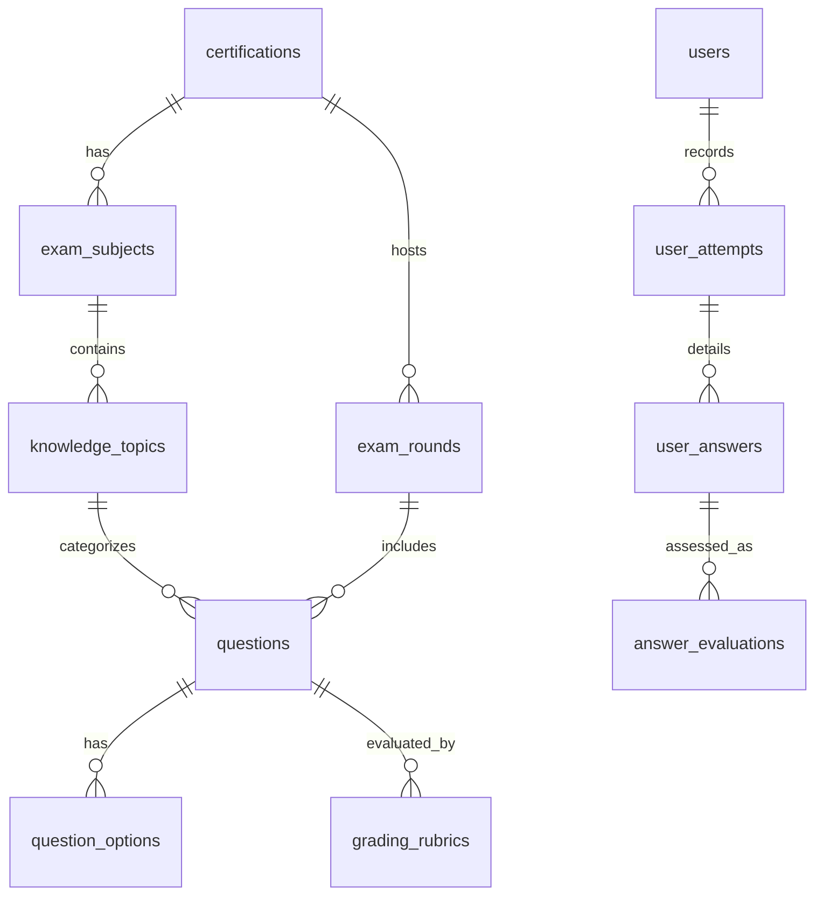
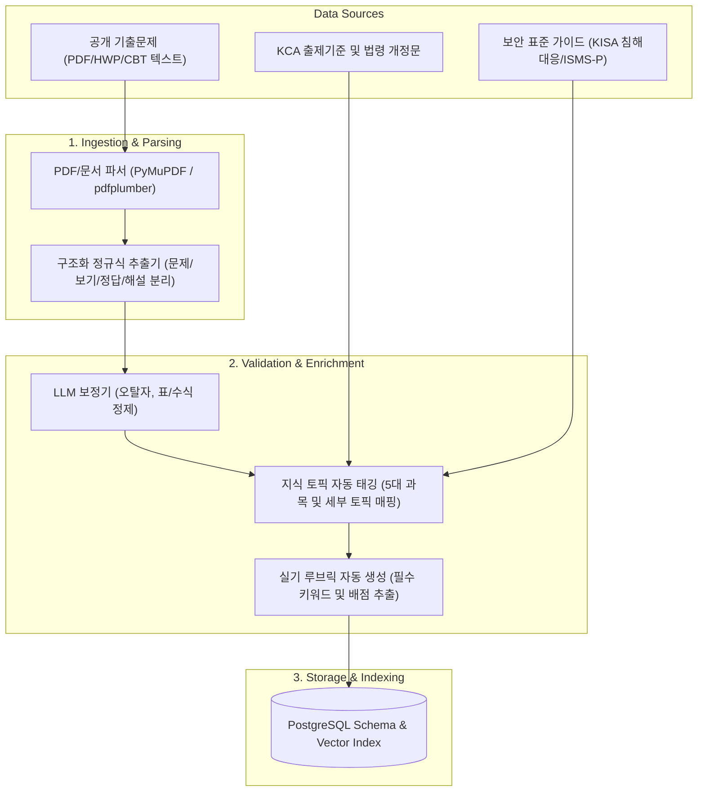

# 데이터 모델 및 수집/정제 파이프라인 상세 설계서

> **문서 버전:** 1.0.0  
> **적용 대상:** 정보보안기사(필기/실기) 및 확장형 자격증 플랫폼 ("PassForge / PassTheExam")

---

## 1. 개요 및 설계 원칙

본 설계서는 시험별 데이터(기출문제, 출제기준, 핵심요약, 실기 루브릭)를 표준화하여 수집·정제·저장하고, 이후 **타 자격증(정보처리기사, 빅데이터분석기사 등)으로 무한 확장**될 수 있도록 범용적이고 정규화된 데이터 스키마 및 ETL 파이프라인을 정의합니다.

### 1.1 핵심 설계 원칙
1. **자격증 메타데이터 분리 (Decoupling)**: 시험 과목 수, 과락 기준, 필기/실기 배점, 문항 유형을 코드 로직이 아닌 DB 설정으로 관리.
2. **다형성 문항 구조 (Polymorphic Question Schema)**:
   - 필기 4지선다형(CBT)
   - 실기 단답형 (동의어/철자오차 처리)
   - 실기 서술형 (필수 키워드 및 의미 임베딩 루브릭)
   - 실기 실무형 (설정 파일, 스크립트, 패킷/로그 분석 등 코드 블록 지원)
3. **지식 그래프 연계 (Knowledge Traceability)**: `개념(Concept)` ↔ `기출문항(Question)` ↔ `오답 취약 태그(Weakness Tag)` 간 다대다 연결.

---

## 2. 데이터베이스 스키마 상세 설계 (PostgreSQL + pgvector)

### 2.1 자격증 및 커리큘럼 메타데이터

#### `certifications` (자격증 마스터)
| 필드명 | 타입 | 제약조건 | 설명 |
| :--- | :--- | :--- | :--- |
| `id` | VARCHAR(50) | PK | 자격증 고유 식별자 (`cissp`, `is_engineer` 등) |
| `title` | VARCHAR(100) | NOT NULL | 자격증 명칭 (예: "정보보안기사") |
| `issuer` | VARCHAR(50) | NOT NULL | 시행기관 (예: "한국방송통신전파진흥원(KCA)") |
| `exam_types` | JSONB | NOT NULL | 지원 시험 유형 (`["WRITTEN", "PRACTICAL"]`) |
| `passing_criteria` | JSONB | NOT NULL | 합격 조건 (필기: 과목당 40점 이상, 전과목 평균 60점 이상 등) |
| `created_at` | TIMESTAMPTZ | DEFAULT NOW() | 생성일 |

#### `exam_subjects` (과목)
| 필드명 | 타입 | 제약조건 | 설명 |
| :--- | :--- | :--- | :--- |
| `id` | UUID | PK | 과목 ID |
| `cert_id` | VARCHAR(50) | FK (`certifications.id`) | 소속 자격증 |
| `subject_no` | INT | NOT NULL | 과목 번호 (1: 시스템, 2: 네트워크, 3: 앱, 4: 일반, 5: 관리법규) |
| `name` | VARCHAR(100) | NOT NULL | 과목명 |
| `description` | TEXT | | 과목 개요 및 출제 비중 |

#### `knowledge_topics` (세부 토픽 / 지식 노드)
| 필드명 | 타입 | 제약조건 | 설명 |
| :--- | :--- | :--- | :--- |
| `id` | UUID | PK | 토픽 ID |
| `subject_id` | UUID | FK (`exam_subjects.id`) | 소속 과목 |
| `parent_topic_id`| UUID | FK (Self) | 대/중/소분류 계층 구조 지원 (Nullable) |
| `code` | VARCHAR(50) | | KCA 출제기준 코드 또는 내부 분류코드 |
| `title` | VARCHAR(150) | NOT NULL | 토픽명 (예: "버퍼 오버플로우 공격 및 대응 기법") |
| `summary_md` | TEXT | | 핵심 요약 마크다운 노트 |
| `keywords` | TEXT[] | | 주요 연관 키워드 배열 |

---

### 2.2 문항 및 채점 기준 스키마 (Questions & Rubrics)

#### `exam_rounds` (회차 관리)
| 필드명 | 타입 | 제약조건 | 설명 |
| :--- | :--- | :--- | :--- |
| `id` | UUID | PK | 회차 ID |
| `cert_id` | VARCHAR(50) | FK | 자격증 ID |
| `exam_type` | VARCHAR(20) | NOT NULL | `WRITTEN` (필기) / `PRACTICAL` (실기) |
| `year` | INT | NOT NULL | 시행 연도 (예: 2024) |
| `round_number`| INT | NOT NULL | 회차 번호 (예: 1회, 2회) |
| `total_questions`| INT | NOT NULL | 총 문항 수 (필기 100문항, 실기 16문항 등) |
| `time_limit_minutes`| INT | NOT NULL | 시험 제한 시간(분) (필기 150분, 실기 180분) |

#### `questions` (문항 마스터)
| 필드명 | 타입 | 제약조건 | 설명 |
| :--- | :--- | :--- | :--- |
| `id` | UUID | PK | 문항 고유 ID |
| `round_id` | UUID | FK (Nullable) | 출제 회차 (모의/예상문제의 경우 Null) |
| `topic_id` | UUID | FK | 연계 지식 토픽 |
| `question_type`| VARCHAR(30) | NOT NULL | `MULTIPLE_CHOICE`, `SHORT_ANSWER`, `ESSAY`, `PRACTICAL_CODE` |
| `question_number`| INT | | 회차 내 번호 |
| `points` | NUMERIC(4,1) | DEFAULT 1.0 | 배점 (필기: 1.0, 실기 단답: 3.0, 서술: 10.0, 실무: 14.0) |
| `stem` | TEXT | NOT NULL | 문제 지문 (마크다운 지원) |
| `scenario_context`| JSONB | | 실기용 부가자료 (로그 텍스트, 설정 파일, 패킷 다이어그램 등) |
| `explanation` | TEXT | NOT NULL | 정답 및 상세 해설 |
| `source_type` | VARCHAR(20) | NOT NULL | `OFFICIAL_PAST` (기출), `MOCK` (예상/변형) |
| `difficulty` | INT | CHECK(1-5) | 난이도 (1: 최하 ~ 5: 최고난이도) |
| `embedding` | VECTOR(1536) | | 유사 문항 검색 및 중복 방지용 임베딩 벡터 |

#### `question_options` (객관식 보기 - 4지선다)
| 필드명 | 타입 | 제약조건 | 설명 |
| :--- | :--- | :--- | :--- |
| `id` | UUID | PK | 보기 ID |
| `question_id` | UUID | FK | 소속 문항 |
| `option_no` | INT | NOT NULL | 보기 번호 (1, 2, 3, 4) |
| `content` | TEXT | NOT NULL | 보기 내용 |
| `is_correct` | BOOLEAN | NOT NULL | 정답 여부 |

#### `grading_rubrics` (실기 주관식/서술형 채점 루브릭)
| 필드명 | 타입 | 제약조건 | 설명 |
| :--- | :--- | :--- | :--- |
| `id` | UUID | PK | 루브릭 ID |
| `question_id` | UUID | FK | 소속 문항 |
| `standard_answers` | TEXT[] | NOT NULL | 표준 정답 및 동의어 목록 (단답형 대비) |
| `mandatory_keywords` | JSONB | NOT NULL | 필수 포함 키워드 및 개별 배점 (예: `[{"kw": "SYN Cookie", "pts": 3.0}]`) |
| `deduction_rules` | JSONB | | 감점 기준 (예: 오탈자, 조건 미충족 시 -1.0) |
| `reference_essay` | TEXT | | 모범 서술형 답안 예시 |
| `essay_embedding` | VECTOR(1536) | | 모범 답안 의미 임베딩 (Cosine Similarity 비교용) |

---

### 2.3 학습 기록 및 AI 채점 이력

#### `user_attempts` (시험/모의고사 응시 세션)
- `id`, `user_id`, `cert_id`, `exam_type`, `mode` (`EXAM_SIMULATION`, `TOPIC_TRAINING`, `WEAKNESS_SOLVE`), `total_score`, `is_passed`, `time_spent_seconds`, `started_at`, `submitted_at`

#### `user_answers` (사용자 제출 답안)
- `id`, `attempt_id`, `question_id`, `submitted_choice` (객관식), `submitted_text` (주관식/서술형), `is_correct`, `earned_points`

#### `answer_evaluations` (AI 정밀 채점 리포트)
- `id`, `user_answer_id`, `matched_keywords` (포함된 필수 키워드), `missing_keywords` (누락된 키워드), `semantic_similarity` (0.0~1.0), `feedback_text` (개선 조언 및 첨삭 코멘트)

---

## 3. 데이터 수집 및 정제 파이프라인 (ETL Architecture)

### 3.1 파이프라인 단계별 처리 명세
1. **Raw 데이터 수집 (`raw/`)**:
   - 연도별 기출문제 텍스트, KCA 공식 출제기준표(PDF), KISA 가이드 문서 수집.
2. **파싱 및 정규화 (`scripts/parse_exam.py`)**:
   - `[1-100]`번 문항 번호, 보기 번호 `(1)~(4)` 패턴 감지 후 JSON 중간 포맷으로 변환.
3. **지식 토픽 자동 매핑 (`scripts/enrich_topics.py`)**:
   - 문항 지문과 해설을 기반으로 5대 과목(`시스템`, `네트워크`, `어플리케이션`, `정보보안일반`, `관리 및 법규`) 및 세부 토픽 ID 자동 연계.
4. **실기 루브릭 생성 (`scripts/generate_rubric.py`)**:
   - 실기 주관식 기출에 대해 LLM을 통해 표준 키워드 세트 및 채점 기준표를 사전 빌드하여 `grading_rubrics`에 적재.

---

## 4. 프론트엔드 & 백엔드 연계 구조

- **백엔드(FastAPI)**:
  - 위 스키마를 기반으로 한 SQLAlchemy 2.0 / Pydantic v2 데이터 모델 정의.
  - CBT 풀이 API, 답안 제출 및 비동기 AI 채점 워커(Celery/BackgroundTasks), 합격 예측 통계 API 제공.
- **프론트엔드(Next.js 14)**:
  - 데이터 모델과 일치하는 TypeScript 타입 인터페이스(`types/exam.ts`) 공유.
  - 4가지 문항 렌더러(CBT 4지선다, 단답 입력기, 서술형 에디터, 시나리오/코드 뷰어) 구현.
