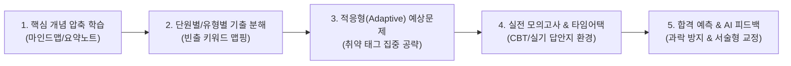
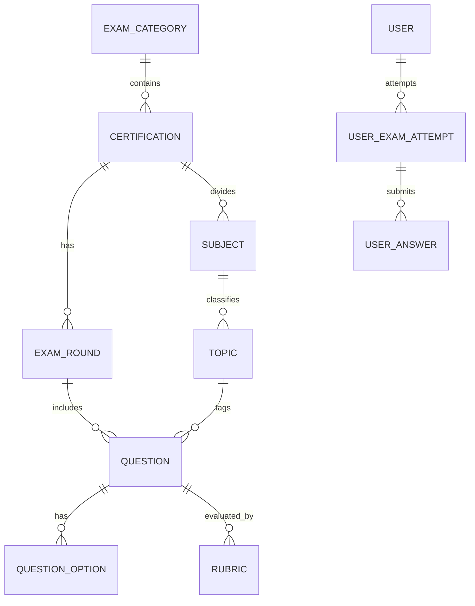
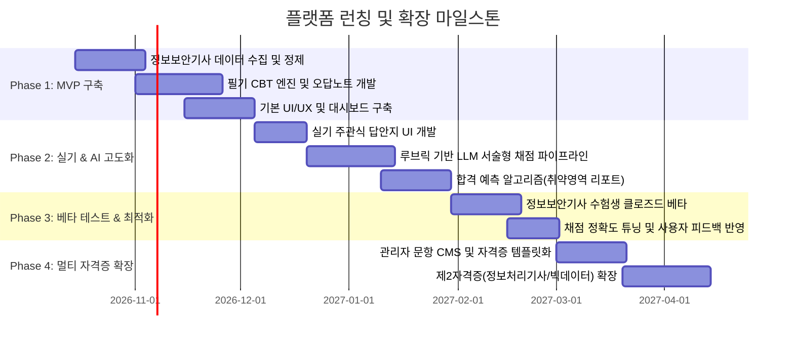

# 자격증 시험 합격 전략 플랫폼 종합 구축 계획서
## : "PassForge" (가칭) — 정보보안기사 특화 및 멀티 자격증 확장형 에듀테크 웹앱

---

## 1. 프로젝트 개요 및 비전

### 1.1 배경 및 목적
- **정보보안기사**는 IT/보안 분야 최고 난이도의 국가공인 자격증으로, 5대 과목(시스템 보안, 네트워크 보안, 애플리케이션 보안, 정보보안 일반, 정보보안 관리 및 법규)의 방대한 이론 범위와 단답형/서술형/실무형으로 구성된 실기 시험의 높은 채점 문턱을 가집니다.
- 본 플랫폼은 **개념 학습 → 기출/유형 분석 → 모의고사 풀이 → AI 채점/해설 → 합격 가능성 진단 및 취약점 피드백**까지 원스톱으로 제공하는 지능형 수험 관리 플랫폼을 지향합니다.
- 초기에는 **정보보안기사(필기/실기)**에 특화하여 킬러 기능(서술형 자동 채점, 법령/보안도구 시나리오 실기 대응)을 검증하고, 이후 빅데이터분석기사, 네트워크관리사, 정보처리기사 등 타 시험으로 즉시 확장 가능한 **범용 멀티 테넌트 시험 엔진(Exam Framework Engine)** 구조로 설계합니다.

---

## 2. 핵심 기능 요구사항 정의

### 2.1 [학습 모드] 단계별 수험 로드맵

1. **지식 베이스 & 개념 학습 (Knowledge Graph)**
   - 보안기사 5대 영역별 핵심 요약집 + 관련 법령(개인정보보호법, 정보통신망법, ISMS-P 인증기준) 및 주요 프로토콜/명령어 치트시트 제공.
   - 각 개념과 기출 출제 회차 간의 양방향 링크(예: "SYN Flooding" 클릭 시 관련 기출 5문항 즉시 확인).

2. **기출문제 아카이브 & 분석 모드**
   - **필기 (객관식 4지선다)**: 회차별 풀이, 과목별 풀이, 빈출 유형별 풀이, 키워드 검색 풀이.
   - **실기 (단답형 / 서술형 / 실무형)**: 실제 시험 답안지 형식(100자 내외 서술, 리눅스 설정 파일 수정, 로그 분석 등).

3. **적응형 문제 풀이 & 취약점 공략 (Adaptive Engine)**
   - 오답 노트 자동 동기화 및 "왜 틀렸는지" 오답 사유 태깅(단순 암기 부족, 개념 혼동, 오답 함정 걸림).
   - 에빙하우스 망각곡선 기반 복습 주기 알림(D+1, D+3, D+7 오답 자동 재출제).

4. **실기 주관식/서술형 특화 AI 정밀 채점 시스템**
   - **키워드 일치도(Recall/Precision)** + **의미적 유사도(Semantic Similarity Embedding)** 기반 점수 산정.
   - **부분 점수 로직**: 필수 핵심 키워드(예: `iptables`, `TCP SYN Cookie`, `최소 권한의 원칙`) 포함 여부 판별.
   - **모범 답안 vs 내 답안 대조 분석 & 첨삭 리포트** 제공.

5. **합격 가능성 및 과락 예측 모델 (Pass Predictor)**
   - **필기**: 과목별 40점 미만(과락) 위험도 계산 + 전과목 평균 60점 달성 확률(몬테카를로 시뮬레이션 or 베이지안 평가 모델).
   - **실기**: 단답형(30점 만점) 목표 달성도 및 서술/실무형(70점 만점) 취약 영역 분석을 통한 예상 합격 확률 산출.

---

## 3. 타 자격증 확장을 위한 범용 아키텍처 가이드라인

향후 정보처리기사, 빅데이터분석기사, 리눅스마스터 등으로 확장하기 위해 **자격증 종속적인 하드코딩을 배제**하고 메타데이터 주도(Metadata-driven) 설계를 적용합니다.

### 3.1 범용 데이터 모델 구조 (Schema Design)

- **`CERTIFICATION`**: 자격증 메타데이터 (이름, 필기 합격기준, 실기 합격기준, 과락점수, 문항수 등 설정 가능)
- **`SUBJECT` / `TOPIC`**: N단계 계층적 커리큘럼 트리 (자격증마다 유연하게 과목 수, 세부 단원 등록)
- **`QUESTION`**: 문제 공통 인터페이스
  - `question_type`: `MULTIPLE_CHOICE`(객관식), `SHORT_ANSWER`(단답형), `ESSAY`(서술형), `PRACTICAL_CODE`(스크립트/설정/로그분석)
  - `metadata`: 난이도, 출제빈도, 연계 태그, 공식 출제기준 분류
- **`RUBRIC`**: 실기 서술형 채점 기준표 (필수 키워드 목록, 감점 요인, 유사 표현 동의어 사전, 부분 배점 룰)

### 3.2 확장성 플러그인 인터페이스 (Extensibility Architecture)
- **채점기 플러그인 (`ScorerStrategy`)**: 객관식 채점기, 정규식 단답형 채점기, LLM 서술형 채점기, 실행형 채점기(CLI/코드 실행용 샌드박스).
- **합격 예측 엔진 (`PredictorStrategy`)**: 시험별 커트라인 룰(평균 60/과락 40, 절대평가, 상대평가 등)을 설정 파일(JSON/YAML)로 동적 주입.

---

## 4. 시스템 기술 스택 및 아키텍처

| 영역 | 권장 기술 스택 | 선정 이유 |
| :--- | :--- | :--- |
| **Frontend** | **Next.js 14+ (App Router), React, TailwindCSS, shadcn/ui** | CBT 풀이 및 반응형 대시보드 구현 용이, SSR/SEO 및 PWA(모바일 웹앱) 지원 최적화 |
| **Backend** | **FastAPI (Python) or NestJS (TypeScript)** | FastAPI: AI 임베딩/채점 모델 및 데이터 과학 라이브러리와 직접 결합 유리 NestJS: 엔터프라이즈 모듈형 아키텍처 및 멀티 테넌트 관리 유리 |
| **Database** | **PostgreSQL (with pgvector), Redis** | 관계형 데이터(문항/채점 결과) + 벡터 임베딩(서술형 답안 유사도 분석) 동시 지원. Redis는 세션/실시간 시험 타이머/캐싱 처리 |
| **AI / NLP** | **Google Gemini API + Sentence-Transformers** | 서술형 모범 답안 첨삭 및 키워드 추출, 문맥 의미 유사도 측정 |
| **인프라** | **Docker, Cloudflare (CDN), Supabase/Neon (DB), Vercel/Fly.io** | 초기 빠른 론칭 및 유연한 스케일아웃 구조 |

---

## 5. 단계별 추진 로드맵 (Phase 1 ~ Phase 4)

---

## 6. 성공적인 플랫폼 런칭을 위한 핵심 차별화 전략

1. **실기 실무형 문제의 "시나리오 시뮬레이터" 기능**
   - 텍스트 문제뿐만 아니라, **Snort 룰셋 작성, iptables 방화벽 규칙, Apache/Nginx 로그 분석, Wireshark 패킷 덤프 분석**을 웹 콘솔 UI에서 바로 실습해볼 수 있는 인터랙티브 컴포넌트 제공.
2. **최신 법령 및 취약점 동향(CVE) 자동 연계**
   - 정보보안기사 5과목(법규)은 최신 개정 법률 반영이 핵심입니다. 법령 개정 사항과 최신 보안 이슈를 학습 카드로 자동 요약 제공.
3. **설명 가능한 AI 채점 리포트 (XAI)**
   - 단순 "6점/14점"이 아닌, `[포함된 핵심 키워드]`, `[누락된 개념]`, `[감점 요인: 불명확한 용어 사용]` 등을 시각적으로 하이라이트하여 수험생의 서술 습관 교정.

---

## 7. 향후 액션 아이템 & 검토 질문
- **초기 프로토타입 범위**: 필기 CBT 모의고사와 실기 서술형 채점 중 어느 쪽을 먼저 검증(PoC)하고 싶으신가요?
- **데이터 확보 방안**: 보유하신 기출문제/요약자료가 있는지, 혹은 공개된 기출 자료를 크롤링/정제하는 파이프라인부터 구축할지 논의가 필요합니다.
