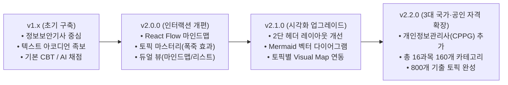
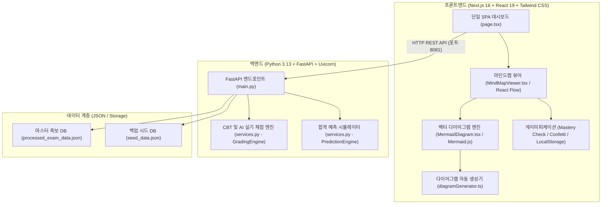

# PassForge 프로젝트 진행 보고서 (v2.2.0)

> **문서 버전**: v2.2.0  
> **작성 일자**: 2026-11-08  
> **프로젝트 명**: PassForge (자격증 시험 단기 합격 전략 플랫폼)  
> **원격 저장소**: [https://github.com/juny79/pass_the_exam.git](https://github.com/juny79/pass_the_exam.git)  
> **기준 최신 커밋**: `ff91ad3` (feat: Add CPPG certification category with 5 subjects 50 categories 250 topics and visual diagrams)

---

## 1. 개요 및 추진 배경 (Executive Summary)

PassForge는 초기 단순 텍스트 나열형 기출 족보 및 CBT 환경에서 출발하여, **"수험생의 학습 몰입도 극대화, 직관적 개념 이해, 능동적 복습 유도"**를 달성하기 위해 지속적으로 진화하고 있습니다.

본 보고서는 **v2.0.0(인터랙티브 마인드맵 & 게이미피케이션 구축)**부터 **v2.1.0(Mermaid 기반 실시간 벡터 시각화 다이어그램 탑재)**, 그리고 최근 완료된 **v2.2.0(개인정보관리사 CPPG 5과목 50개 카테고리 250개 토픽 전면 확장 구축)**까지의 기능적·구조적 변경 내역과 기술 스택, 데이터베이스 아키텍처를 총망라하여 정리합니다.

---

## 2. 버전별 상세 진행 내역 (Version History)

### 📌 [v2.2.0] 개인정보관리사(CPPG) 자격증 전면 구축 및 플랫폼 확장 (2026-11-07 ~ 현재)
* **CPPG 마스터 데이터셋 구축 (`data/build_cppg_data.py`)**:
  - 한국CPO포럼 주관 출제기준 및 **2023년 전면개정 개인정보 보호법**을 완벽 반영한 5개 과목 50개 카테고리 250개 기출 핵심 토픽 데이터 구축.
  - 1과목(개인정보 보호의 이해: 10개 카테고리/50개 토픽), 2과목(개인정보 보호 관련 법률: 10개 카테고리/50개 토픽), 3과목(개인정보 관리체계 수립: 10개 카테고리/50개 토픽), 4과목(개인정보 생명주기 관리: 10개 카테고리/50개 토픽), 5과목(개인정보 기술적·물리적 보호조치: 10개 카테고리/50개 토픽).
* **CPPG 특화 시각화(Mermaid) 룰셋 연동 (`diagramGenerator.ts`)**:
  - 개인정보 생명주기 4단계 및 분리보관 흐름도.
  - 가명정보 vs 익명정보 vs 개인정보 개념 체계도.
  - 제3자 제공(법 제17조) vs 처리위탁(법 제26조) 비교도.
  - 72시간 이내 정보주체 유출 통지 및 기관 신고 타임라인 다이어그램.
  - 프라이버시 수학 모델 (k-익명성 ➔ l-다양성 ➔ t-근접성) 발전도.
* **CPPG 실전 CBT 및 AI 실기 채점 문항 탑재**:
  - 객관식 필기 5문항 (가명정보 재식별 금지, 주민번호 원칙적 금지, 유출 통지 5대 필수 항목 등).
  - 실기/서술형 4문항 (제3자 제공 vs 처리위탁 비교 10점, 필수 암호화 4대 대상 및 일방향 해시 10점, 비식별 3대 모델 10점, CPO 독립성 단답 5점).

---

### 📌 [v2.1.0] 시각화 다이어그램 탑재 및 마인드맵 UI 레이아웃 최적화 (2026-10-22)
* **상단 과목 탭 가려짐 버그 수정 및 2단 분리 레이아웃 구축 (`MindMapViewer.tsx`)**:
  - 기존 1행 레이아웃에서 발생하던 "과목명 긴 탭이 우측 정복률 게이지에 가려지는 현상" 완전 해결.
  - **1행**: 전폭 가로 스크롤 과목 탭 레일(과목 번호 + 국문명 + 영문 코드 표시).
  - **2행**: 현재 과목 상세 설명 + 실시간 정복률(%) 텍스트 및 프로그레스 바 분리 배치.
* **Mermaid 벡터 다이어그램 렌더러 구현 (`MermaidDiagram.tsx`)**:
  - 브라우저 클라이언트 사이드에서 즉시 SVG 벡터로 렌더링되어 지연 없는 로딩 및 고해상도 품질 보장.
  - 다크 모드 맞춤형 네온/인디고 컬러 테마(`theme: 'dark'`) 적용.
* **토픽별 자동 다이어그램 생성기 연동 (`diagramGenerator.ts`)**:
  - 메모리 구조(스택/힙/BSS/Data/Text), 암호화 키 분배, OSI 7계층 패킷 캡슐화, 보안장비 방어체계, 하인리히 도미노 이론, 위험성평가 5단계 등 주요 기술 토픽 시각화.
  - 토픽 클릭 시 우측 슬라이드 서랍장 최상단에 **[Visual Map]**을 배치하여 텍스트보다 시각 구조를 우선 인지하도록 UX 개편.

---

### 📌 [v2.0.0] 인터랙티브 마인드맵 노드 트리 & 게이미피케이션 (2026-10-22)
* **React Flow 기반 인터랙티브 마인드맵 (`@xyflow/react`)**:
  - `[루트 과목 노드]` ➔ `[세부 카테고리 노드]` ➔ `[기출 토픽 노드]`의 3계층 수평 계층 트리 자동 배치.
  - 캔버스 줌(Zoom), 패닝(Pan), 뷰 맞춤(Fit View), 카테고리 접기/펼치기 인터랙션 지원.
* **게이미피케이션(노드 정복 마스터리 & 축하 애니메이션)**:
  - 토픽 정복 완료 시 `canvas-confetti` 폭죽 파티클 효과 실행.
  - 정복된 토픽 노드는 에메랄드/골드 하이라이트로 빛나며 실시간 정복률에 반영.
  - 브라우저 `localStorage` 동기화를 통한 학습 이력 영구 보존.
* **듀얼 뷰(Dual View) 지원**:
  - 상단 1클릭 토글 스위치(`[마인드맵 뷰]` ↔ `[아코디언 뷰]`)를 통해 사용자의 선호에 따라 시각적 탐색과 빠른 텍스트 복습을 자유롭게 전환.

---

### 📌 [v1.5.0] 산업안전기사 6과목 60개 카테고리 300개 토픽 구축 및 정제 (2026-10-21 ~ 2026-10-22)
* 산업안전기사(Q-Net 국가기술) 6대 과목 60개 카테고리 300개 토픽 데이터 정규화.
* 비정형적이거나 수험에 방해되는 임의 두음 암기 문구 완전 삭제 및 공학적 핵심 요약/실기 공략 포인트로 데이터 정제 완료.
* 필기 과락 방지 및 평균 60점 시뮬레이션이 가능한 6개 과목 합격 예측 엔진 구축.

---

## 3. 현행 시스템 아키텍처 및 자격증 데이터 현황

### 3.1 3대 자격증 데이터베이스 현황 요약

| 자격증 명칭 | 대상 분야 / 주관 | 과목 수 | 카테고리 수 | 기출 토픽 수 | 실전 문제 수 | 주요 시각화 테마 |
| :--- | :--- | :---: | :---: | :---: | :---: | :--- |
| **정보보안기사** (`is_engineer`) | IT·보안 / KCA | 5과목 | 50개 | 250개 | 9문항 | 메모리 세그먼트, 암호키 분배, 네트워크 캡슐화, 보안장비 체계 |
| **산업안전기사** (`ind_safety_engineer`) | 안전·제조 / Q-Net | 6과목 | 60개 | 300개 | 9문항 | 하인리히 도미노 이론, 위험성평가 5단계, 방호장치 점검 |
| **개인정보관리사** (`cppg`) | 법률·컴플라이언스 / CPO포럼 | 5과목 | 50개 | 250개 | 9문항 | 개인정보 생명주기, 가명정보 체계, 72시간 유출신고, 비식별 모델 |
| **합계 (전체)** | **3대 전문 자격증** | **16과목** | **160개** | **800개** | **27문항** | **토픽별 맞춤형 실시간 벡터 다이어그램 지원** |

---

### 3.2 시스템 아키텍처 다이어그램

---

## 4. 핵심 기술 스택 및 라이브러리

| 계층 | 기술 / 라이브러리 | 적용 버전 | 주요 용도 및 역할 |
| :--- | :--- | :--- | :--- |
| **Frontend Framework** | **Next.js** | 16.4.0 (App Router) | 고성능 서버 사이드/정적 렌더링 및 SPA 라우팅 |
| **UI Library** | **React** | 19.x | 최신 리액트 상태 관리 및 훅 기반 컴포넌트 아키텍처 |
| **MindMap Engine** | **@xyflow/react** | 최신 릴리스 | 인터랙티브 노드 트리 그래프, 패닝/줌, 커스텀 노드 |
| **Diagram Engine** | **mermaid** | 11.x | 클라이언트 사이드 SVG 벡터 다이어그램 렌더링 |
| **Styling & Theme** | **Tailwind CSS** | 3.4.x | 슬레이트/인디고 중심의 프리미엄 다크 모드 디자인 |
| **Icons & Effects** | **lucide-react**, **canvas-confetti** | 최신 릴리스 | 직관적 시스템 아이콘 및 토픽 정복 축하 폭죽 파티클 |
| **Backend Framework**| **FastAPI** | 0.115.x | 고속 비동기 REST API 서버 (포트 8081) |
| **ASGI Server** | **Uvicorn** | 0.32.x | 파이썬 비동기 웹 서버 |
| **Data Schema** | **Pydantic** | 2.10.x | 엄격한 타입 검증 및 데이터 모델 직렬화 |

---

## 5. 향후 로드맵 (Next Steps)

1. **마케팅 바이럴 기능 구현**:
   - 학습 완료율 및 과목별 점수를 기반으로 한 **"나의 과목별 정복 레이더 차트 & 합격 부적 카드"** 이미지 원클릭 다운로드/SNS 공유 기능.
2. **AI 실기 채점 피드백 고도화**:
   - 서술형 답안 제출 시 단순 키워드 매칭을 넘어, LLM API와 연동된 정밀 문장 유사도 및 감점 사유 해설 제공.
3. **오답 노트 및 북마크 전용 탭 신설**:
   - 풀이 중 틀린 문제나 자주 헷갈리는 마인드맵 토픽 노드만 모아서 집중 복습할 수 있는 개인화 서재 기능.
4. **모바일 반응형 터치 인터랙션 최적화**:
   - 모바일 환경에서의 마인드맵 노드 터치 확대/축소 제스처 최적화 및 하단 시트(Bottom Sheet) 모달 연동.
